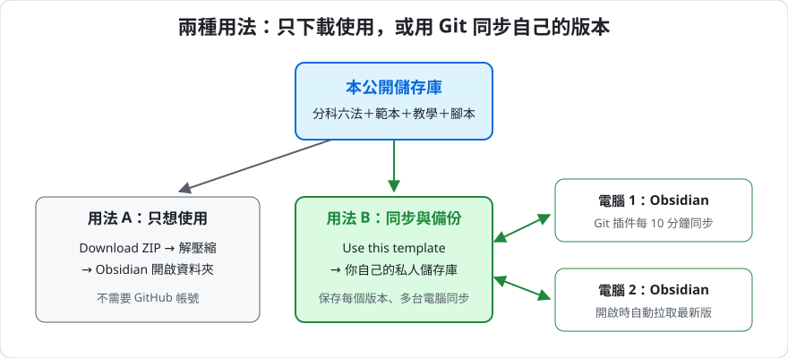

# 分科六法庫：台灣法規 Obsidian 逐條筆記庫

把 23 部常用台灣法規做成「一條一頁」的 Obsidian 筆記庫。每條頁面附上條文原文、上下條導覽、互相引用的連結，以及六個筆記欄位，下載後用 Obsidian 開啟即可開始讀法條、寫筆記。

## 特色

- **一條一頁，共 6,362 頁**：條文內引用他條的地方都變成連結，可以點過去或懸停預覽；引用外部法規時，頁面附上該條全文。
- **六個筆記欄位**：法條解析、思考脈絡（可畫流程圖）、實務見解、爭點、近年考試出現、相關考題。
- **條文與筆記分開**：條文放在「條文區」，修法時用腳本更新，你寫的筆記完整保留。
- **進度看板**：用 Obsidian 內建的 Bases 統計整理進度、考試出現次數、效力異動條文。
- **效力標註**：憲法依增修條文標註停止適用、不適用等狀態；失效、部分失效條文附依據。
- **條文來源**：全國法規資料庫下載檔，逐條核對過。沒有官方條名的條文由編者自擬條名，一律標「〔自擬〕」。

## 收錄法規

| 分類 | 法規 |
| --- | --- |
| 公法 | 中華民國憲法、中華民國憲法增修條文、憲法訴訟法、行政程序法、行政訴訟法、行政罰法、行政執行法、國家賠償法 |
| 民事法 | 民法、民事訴訟法、家事事件法、強制執行法、司法院釋字第七四八號解釋施行法 |
| 刑事法 | 中華民國刑法、刑事訴訟法、國民法官法、通訊保障及監察法 |
| 商事法與智慧財產權法 | 公司法、保險法、證券交易法、著作權法、商標法、專利法 |

各法所用版本見 [`tools/使用指引.md`](tools/使用指引.md) 第七節；每條頁面的 `source` 屬性也記有下載檔日期。法規會修正，**引用前請以[全國法規資料庫](https://law.moj.gov.tw)為準**。

## 快速開始（3 步）

1. 安裝 [Obsidian](https://obsidian.md)（免費）。
2. 本頁右上方綠色按鈕「**Code**」→「**Download ZIP**」，解壓縮到電腦上的一般資料夾。
3. 打開 Obsidian →「**Open folder as vault**」→ 選解壓縮出來的資料夾。

開啟後先看 `分科六法整理/00-總覽與看板/分科六法總覽.md`。按 `Ctrl＋O`（Mac 為 `Cmd＋O`）輸入「刑法271」就能跳到該條。

想要**保存每個版本、多台電腦同步**，或想**自己新增、更新法規**，請看完整教學。

## 完整教學

[`教學/完整教學.md`](教學/完整教學.md) 從零開始說明，適合沒用過 Obsidian、Git 和 GitHub 的人：

1. 安裝 Obsidian、開啟本庫、認識介面
2. 分科六法庫的使用方式（頁面構造、寫筆記、看板、範本）
3. 用 Git 與 GitHub 備份和同步（註冊、雙重驗證、GitHub Desktop、Obsidian Git 插件、救援與衝突處理）
4. 用 Claude Code 的 law-library Skill 新增或更新法規
5. 常見問題與名詞對照

## 資料夾結構

| 路徑 | 內容 |
| --- | --- |
| `分科六法整理/` | 逐條頁面、法規總覽、`00-總覽與看板/`（總覽頁與進度看板） |
| `99-範本/` | 法條筆記範本、解釋判決筆記範本 |
| `教學/` | 完整教學與示意圖 |
| `tools/` | `法規庫.py`（產生與更新頁面的 Python 腳本）、各法設定檔、使用指引 |
| `.claude/skills/law-library/` | 給 Claude Code 用的 Skill，讓 AI 依指引新增或更新法規 |
| `00-Inbox/`、`附件/` | 新筆記與附件的預設位置 |

## 授權

- **法規條文**：依著作權法第 9 條第 1 項第 1 款，憲法、法律、命令或公文不得為著作權之標的。
- **程式與 Skill**（`tools/`、`.claude/`）：[MIT License](LICENSE)。
- **教學文件、示意圖、頁面版型、筆記範本、自擬條名**：[創用 CC 姓名標示 4.0 國際（CC BY 4.0）](https://creativecommons.org/licenses/by/4.0/deed.zh-hant)。可以自由使用、修改、轉傳，包括商業用途，但請標示出處（本儲存庫名稱與網址）。

## 免責聲明

本庫是學習用的整理工具，不構成法律意見。條文內容以全國法規資料庫公告為準；自擬條名僅為方便閱讀，並非官方名稱。發現錯誤歡迎在 Issues 回報。
