# 憲法訴訟法第53條

%% 條文區開始：本區由腳本產生，修法更新時會整段覆寫，筆記請寫在條文區以外 %%
[[憲法訴訟法第52條|← 第52條 〔自擬〕違憲法規範之失效時點]] ｜ [[憲法訴訟法|法規總覽]] ｜ [[憲法訴訟法第54條|第54條 〔自擬〕定期失效期間內法院之審理 →]]

> [!quote] 條文　第三章 法規範憲法審查及裁判憲法審查案件／第一節 國家機關、立法委員聲請法規範憲法審查
> 判決宣告法規範立即失效或溯及失效者，於判決前已繫屬於各法院而尚未終結之案件，各法院應依判決意旨為裁判。
>
> 判決前適用立即失效之法規範作成之確定裁判，其效力除法律另有規定外，不受影響。
>
> 判決前以溯及失效之法規範為基礎作成之確定裁判，得依法定程序或判決意旨救濟之；其為刑事確定裁判者，檢察總長得據以提起非常上訴。

%% 條文區結束 %%

## 法條解析

## 思考脈絡

%% 流程圖範本，要用時刪掉前後的百分號：

```mermaid
flowchart TD
    A[起點] --> B{判斷}
    B -->|是| C[結論一]
    B -->|否| D[結論二]
```

%%

## 實務見解

## 爭點

## 近年考試出現

| 年度 | 考試 | 科目 | 題號 | 考點 |
| --- | --- | --- | --- | --- |
|  |  |  |  |  |

## 相關考題

## 相關條文與解釋

