# 保險法第149-4條 解散後之清算程序

%% 條文區開始：本區由腳本產生，修法更新時會整段覆寫，筆記請寫在條文區以外 %%
[[保險法第149-3條|← 第149-3條 監管接管期限與終止]] ｜ [[保險法|法規總覽]] ｜ [[保險法第149-5條|第149-5條 監管人接管人清理人與清算人之報酬 →]]

> [!quote] 條文　第五章 保險業／第一節 通則
> 依[[保險法第149條|第一百四十九條]] (〔自擬〕違法經營之處分及監管、接管、停業清理、解散)為解散之處分者，其清算程序，除本法另有規定外，其為公司組織者，準用公司法關於股份有限公司清算之規定；其為合作社組織者，準用合作社法關於清算之規定。但有公司法[[公司法第335條|第三百三十五條]] (特別清算之要件)特別清算之原因者，均應準用公司法關於股份有限公司特別清算之程序為之。

%% 條文區結束 %%

## 法條解析

## 思考脈絡

%% 流程圖範本，要用時刪掉前後的百分號：

```mermaid
flowchart TD
    A[起點] --> B{判斷}
    B -->|是| C[結論一]
    B -->|否| D[結論二]
```

%%

## 實務見解

## 爭點

## 近年考試出現

| 年度 | 考試 | 科目 | 題號 | 考點 |
| --- | --- | --- | --- | --- |
|  |  |  |  |  |

## 相關考題

## 相關條文與解釋

