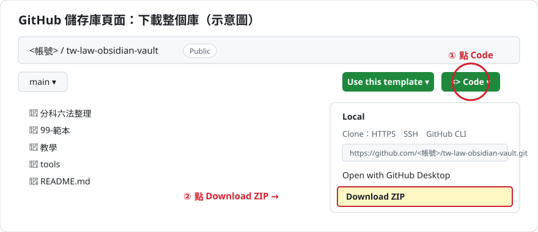
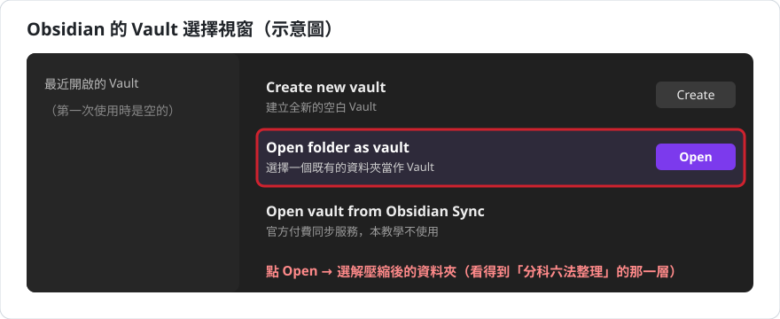
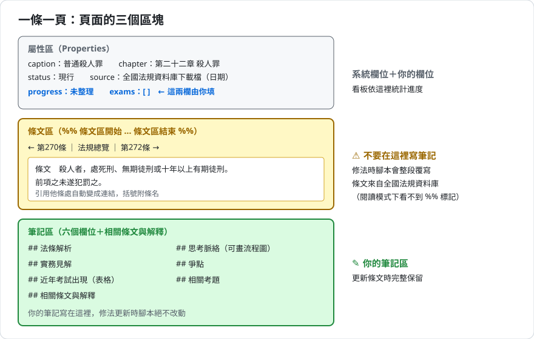
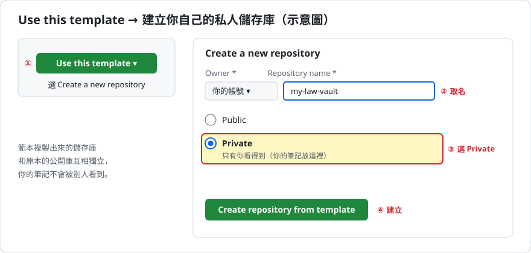
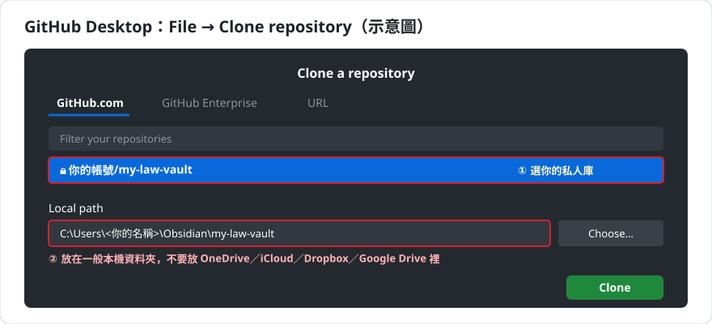
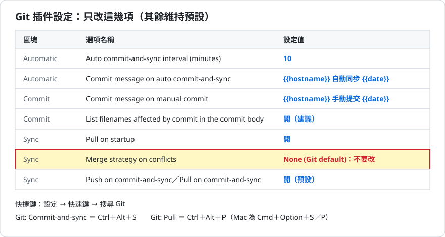
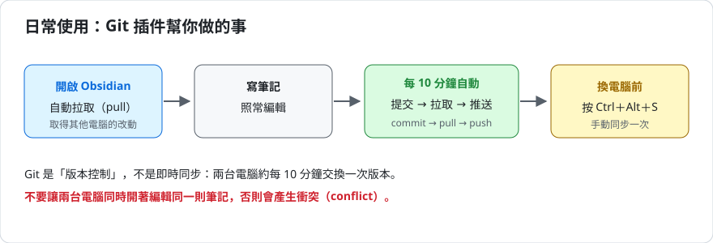
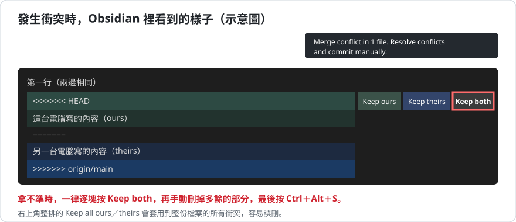
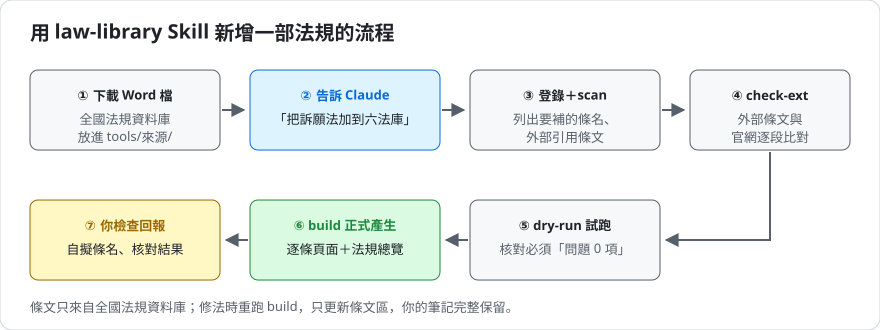

# 分科六法庫完整教學：從安裝 Obsidian 到用 Git 同步、用 AI 擴充法規

這份教學寫給**完全沒用過 Obsidian、Git、GitHub 的人**。照順序做就能完成；每一節開頭都會說明「這一步在做什麼、為什麼」。

介面的按鈕名稱會隨軟體版本改變。本文寫的是撰寫時（2026 年 10 月）的名稱，英文介面的按鈕附原文；畫面和本文不同時，請找意思相同的按鈕。文中的圖都是**示意圖**，不是真實截圖。

## 目錄

（以下目錄連結在 GitHub 網頁上可以點；在 Obsidian 裡請用右側的「大綱」面板跳轉。）

- [零、先決定你要哪一種用法](#零先決定你要哪一種用法)
- [第一部分　安裝 Obsidian 並開啟本庫](#第一部分安裝-obsidian-並開啟本庫)
- [第二部分　分科六法庫的使用方式](#第二部分分科六法庫的使用方式)
- [第三部分　用 Git 與 GitHub 備份和同步](#第三部分用-git-與-github-備份和同步)
- [第四部分　用 Claude Code 的 law-library Skill 新增或更新法規](#第四部分用-claude-code-的-law-library-skill-新增或更新法規)
- [附錄　常見問題與名詞對照](#附錄常見問題與名詞對照)

---

## 零、先決定你要哪一種用法


| | 用法 A：只想使用 | 用法 B：同步與備份 |
| --- | --- | --- |
| 適合誰 | 只在一台電腦讀法條、寫筆記 | 有兩台以上電腦，或想保存每個版本 |
| 需要什麼 | Obsidian | Obsidian、GitHub 帳號、Git、GitHub Desktop |
| 要做的部分 | 第一、二部分 | 第一、二、三部分（第一部分的下載步驟改用第三部分的方式） |
| 花多少時間 | 約 10 分鐘 | 第一次約 1 小時 |

不論哪一種，之後想自己新增或更新法規，都可以再看第四部分。

**先講清楚 Git 是什麼**：Git 是「版本控制」工具，每次同步都會把整個筆記庫存成一個版本，任何時候都能找回過去的內容。它**不是即時同步服務**：兩台電腦大約每 10 分鐘交換一次版本，不像 Google 文件那樣能即時看到對方打字。

---

## 第一部分　安裝 Obsidian 並開啟本庫

### 1-1　安裝 Obsidian

1. 到 Obsidian 官網 https://obsidian.md ，點「**Download**」，下載你作業系統的版本並安裝。Obsidian 個人使用免費。
2. 打開 Obsidian。介面語言可以在左下角齒輪「設定」的第一個分頁（英文介面為「General」）裡的「Language」切換成繁體中文。

**Obsidian 是什麼**：一個讀寫 Markdown（`.md`）純文字檔的筆記軟體。所有筆記都是你電腦上的一般檔案，不會被鎖在某家公司的伺服器裡。Obsidian 把「一個資料夾」當作一個 **Vault（筆記庫）**。

### 1-2　下載本庫（用法 A）

> 要走用法 B 的人跳過這一步，改照第三部分 3-5、3-6 節取得本庫。



1. 打開本庫的 GitHub 頁面，點檔案清單右上方綠色的「**Code**」按鈕。
2. 在下拉選單最下面點「**Download ZIP**」。
3. 把下載的 ZIP 檔解壓縮，放到一個**固定的位置**，例如 `文件\Obsidian\分科六法庫`。

**放哪裡要注意**：

- 解壓縮後只保留**一層**資料夾。打開資料夾時，應該直接看到 `分科六法整理`、`99-範本`、`教學` 等資料夾。如果還要再點進一層 `tw-law-obsidian-vault-main` 才看得到，就把裡面那層搬出來。
- 以後如果打算改用 Git 同步（用法 B），**不要**把筆記庫放在 OneDrive、iCloud Drive、Dropbox、Google Drive 等雲端同步資料夾內。兩套同步機制同時處理同一個資料夾，可能損毀 Git 的紀錄，或產生大量「檔名-電腦名稱」的衝突副本。只用用法 A 的話，放在雲端資料夾沒有大問題。

### 1-3　用 Obsidian 開啟本庫



1. 打開 Obsidian。第一次開會出現 Vault 選擇畫面；如果已經開著別的 Vault，點左下角的 Vault 名稱 →「**Manage vaults…**」（管理 Vault）。
2. 找「**Open folder as vault**」（開啟資料夾作為 Vault），點右邊的「**Open**」。
3. 選剛才解壓縮的資料夾，按「選擇資料夾」。
4. 如果 Obsidian 詢問是否信任這個 Vault 的作者，可以放心選信任。本庫**沒有安裝任何第三方插件**，只用 Obsidian 內建的功能。

### 1-4　認識介面

- **左側檔案清單**：所有資料夾和筆記。
- **左下角齒輪**：設定。
- **`Ctrl＋O`**（Mac 為 `Cmd＋O`）：快速切換，輸入檔名的一部分就能跳過去。
- **`Ctrl＋P`**（Mac 為 `Cmd＋P`）：指令面板，Obsidian 的所有功能都能在這裡搜尋執行。
- **`Ctrl＋E`**（Mac 為 `Cmd＋E`）：在「閱讀模式」和「編輯模式」之間切換。

---

## 第二部分　分科六法庫的使用方式

### 2-1　從總覽頁開始

打開 `分科六法整理/00-總覽與看板/分科六法總覽.md`，上面有：

- **法規目錄**：依公法、民事法、刑事法、商事法與智慧財產權法分類，點法規名稱進入該法的「法規總覽」頁，依編章節列出全部條文。
- **整理進度看板**：嵌入的 `法條整理進度.base`，用 Obsidian 內建的 **Bases** 功能，自動彙整所有條文頁的屬性。看板分成「全部條文」「待整理」「整理中」「考試熱門」「效力異動」「依整理進度分組」幾個檢視。

**跳到某一條**：按 `Ctrl＋O`，輸入「刑法271」「民法184」「刑訴159-1」這類簡稱加條號，就能直接跳到該條。每條頁面都設了簡稱別名。

### 2-2　一條一頁的頁面構造



每條頁面分成三個區塊：

1. **屬性區（Properties）**：在最上面。系統欄位有條名 `caption`、所屬編章 `part`／`chapter`、效力 `status`、來源 `source` 等；**你自己填的欄位**有兩個：
   - `progress`：整理進度，填「未整理」「整理中」或「完成」。
   - `exams`：考試出現紀錄，例如 `[113律師, 112司法官]`。看板會自動統計出現次數。
2. **條文區**：夾在 `%% 條文區開始 … %%` 和 `%% 條文區結束 %%` 兩行標記之間（閱讀模式下看不到標記）。內容包括上一條／下一條導覽、條文原文、引用連結、外部法規條文、編註與效力警示。
   - **不要在條文區寫筆記**。修法更新時，腳本會整段覆寫這一區。
3. **筆記區**：條文區下面的六個筆記欄位「法條解析」「思考脈絡」「實務見解」「爭點」「近年考試出現」「相關考題」，另加一個「相關條文與解釋」。**你的筆記寫在這裡**，更新條文時完整保留。
   - 「思考脈絡」裡預留了一段 Mermaid 流程圖範本，刪掉前後的 `%%` 就會顯示成流程圖。

### 2-3　頁面上的幾個標記

- **〔自擬〕**：官方沒有條名的條文，由編者依條文內容或通行學說用語自擬條名，**不是官方名稱**，引用時請注意。
- **效力狀態**：屬性 `status` 除了「現行」，還有「已刪除」「失效」「部分失效」，以及憲法依增修條文標註的「停止適用」「不適用」「不受其限制」等。失效、部分失效，以及依增修條文標註效力的條文，條文框內有一行「⚠️ 效力」說明依據與查核日期；已刪除的條文只顯示「（刪除）」。
- **連結到還沒建立的頁面**：例如部分大法官解釋、憲法法庭判決。連結會顯示成淡色，點下去 Obsidian 會在新筆記的預設位置 `00-Inbox/` 建立同名的空白頁面。請把它搬到 `分科六法整理/05-憲法法庭判決及大法官解釋/`（在檔案清單裡拖曳即可，連結會自動跟著更新），再用 `99-範本/解釋判決筆記範本.md` 填入內容（見 2-5）。檔名維持連結文字，例如「釋字第775號」。

### 2-4　好用的內建功能

- **懸停預覽**：滑鼠移到條文裡的連結上可以預覽該條（編輯模式下要按住 `Ctrl`／`Cmd`）。
- **反向連結**：右側欄的「反向連結」（Backlinks）面板，顯示哪些條文引用了本條。讀總則條文時特別好用。
- **關係圖**：`Ctrl＋P` 搜尋「Graph」，可以看到條文之間的引用網絡。
- **全文搜尋**：`Ctrl＋Shift＋F`（Mac 為 `Cmd＋Shift＋F`）。

### 2-5　用範本寫新筆記

本庫已經把 Obsidian 內建「範本」（Templates）功能的資料夾設成 `99-範本`：

1. 新增一則筆記，取好檔名。
2. `Ctrl＋P` 搜尋「Templates: Insert template」（插入範本），選要用的範本。

`法條筆記範本.md` 適合手動建立本庫沒收錄的法條；`解釋判決筆記範本.md` 適合大法官解釋與憲法法庭判決。

### 2-6　新筆記和附件放哪裡

本庫設定新筆記預設放 `00-Inbox/`，附件（圖片、PDF）放 `附件/`。可以在「設定」→「檔案與連結」修改。

---

## 第三部分　用 Git 與 GitHub 備份和同步

這一部分會依序完成：註冊 GitHub → 安裝 Git 並做基本設定 → 安裝 GitHub Desktop → 用本庫建立你自己的**私人儲存庫** → 複製到電腦 → 讓命令列 Git 能登入 → 安裝 Obsidian 的 Git 插件 → 測試 → 學會救援。

先認識幾個名詞（附錄有完整對照）：

- **儲存庫（repository）**：Git 管理的一個資料夾，連同它所有的歷史版本。
- **提交（commit）**：把目前的狀態存成一個版本。
- **推送（push）**：把電腦上的新版本上傳到 GitHub。
- **拉取（pull）**：把 GitHub 上的新版本下載到電腦。

### 3-1　註冊 GitHub 帳號並開啟雙重驗證

1. 到 https://github.com ，點「**Sign up**」。填 Email、密碼、使用者名稱（Username）。
   - 使用者名稱會出現在儲存庫網址中，例如 `github.com/使用者名稱/...`，建議用英文暱稱，**不要用真實全名**。
   - 註冊後會收到 Email 驗證碼，輸入即可。問卷頁可以一律略過，選免費方案。
   - 也可以直接用 Google 帳號註冊；這樣的話，**你的 Google 帳號也要開好兩步驟驗證**，因為它等於 GitHub 的鑰匙。
2. **開啟雙重驗證（Two-factor authentication，2FA）**：右上角頭像 →「**Settings**」→ 左側「**Password and authentication**」→「**Enable two-factor authentication**」。
   - 手機先安裝驗證器 App（例如 Google Authenticator、Microsoft Authenticator），掃描畫面上的 QR code，輸入 App 顯示的 6 位數碼。
   - **復原碼（recovery codes）一定要下載保存**。手機遺失時，這是救回帳號的唯一方法。存在密碼管理器或印出來，不要只存在同一台電腦裡。
   - 完成後，「Authenticator app」旁會顯示「Configured」。
3. **隱藏 Email（建議）**：Settings → 左側「**Emails**」→ 勾選「**Keep my email addresses private**」。畫面會出現一個 `數字+使用者名稱@users.noreply.github.com` 的代用信箱（noreply 信箱），**把它記下來**，3-2 節會用到。同一頁的「**Block command line pushes that expose my email**」也建議勾選。

**為什麼**：每個提交都會附上作者 Email。用 noreply 信箱，真實 Email 就不會出現在版本紀錄裡。

> 任何時候都不要把密碼、驗證碼、復原碼、權杖（token）貼給別人或貼到聊天視窗裡。

### 3-2　安裝 Git 並設定提交者資訊

Obsidian 的 Git 插件在電腦版上，是呼叫你電腦上安裝的 Git 程式。GitHub Desktop 內建的 Git 不一定能讓插件使用，所以要另外安裝。

**Windows**

1. 到 https://git-scm.com ，下載 Git for Windows 並安裝。安裝過程的選項**全部維持預設**即可；預設會一併安裝 **Git Credential Manager**，負責之後用瀏覽器登入 GitHub。
2. 安裝完成後，打開「Git Bash」或「PowerShell」，輸入：

   ```bash
   git --version
   ```

   顯示類似 `git version 2.xx.x.windows.x` 就成功了。

**macOS**

1. 打開「終端機」（Terminal），輸入 `git --version`。如果還沒安裝，系統會跳出安裝「命令列開發者工具」（Command Line Tools）的視窗，點「安裝」。
2. 裝好後再輸入一次 `git --version` 確認。

**設定提交者資訊**（兩個平台都要做）：把下面的名稱和信箱換成你的 GitHub 使用者名稱和 3-1 節的 noreply 信箱。

```bash
git config --global user.name "你的GitHub使用者名稱"
git config --global user.email "數字+使用者名稱@users.noreply.github.com"
git config --global init.defaultBranch main
git config --global core.quotepath false
```

- `user.name`／`user.email`：每個提交上記錄的作者。
- `init.defaultBranch main`：新儲存庫的主分支（branch）叫 main，和 GitHub 一致。
- `core.quotepath false`：讓中文檔名正常顯示，不會變成 `\346\263\225` 這種亂碼。

輸入 `git config --global --list` 可以檢查設定。

### 3-3　安裝並登入 GitHub Desktop

GitHub Desktop 是 GitHub 官方的圖形介面工具，用來建立、複製儲存庫，以及處理少數需要手動處理的狀況。

1. 到 https://desktop.github.com 下載並安裝。
2. 打開後點「**Sign in to GitHub.com**」，瀏覽器會跳出授權頁，點綠色的授權按鈕（例如「Authorize desktop」或「Continue」），再允許瀏覽器開啟 GitHub Desktop。
3. 出現「**Configure Git**」畫面時，確認 Name 和 Email 與 3-2 節相同。**Email 必須是 noreply 信箱**，不是你的真實信箱。按「**Finish**」。

### 3-4　（若是從 ZIP 開始的）把現有的筆記庫變成儲存庫

> 走用法 B、還沒下載本庫的人，跳過本節，直接看 3-5。

如果你已經照 1-2 節下載 ZIP，也寫了一些筆記，想改用 Git 同步：

1. 確認筆記庫不在 OneDrive、iCloud Drive 等雲端同步資料夾內（見 1-2 節）。在雲端資料夾內的話，先**關閉 Obsidian、完整備份一份**，再把整個資料夾搬到一般本機資料夾，最後在 Obsidian 重新開啟。
2. GitHub Desktop →「**File**」→「**Add local repository…**」→ 選筆記庫資料夾。出現「This directory does not appear to be a Git repository」時，點「**create a repository**」。建立畫面裡的「Git ignore」選 **None**、「License」選 **None**、不要勾「Initialize this repository with a README」（本庫已經附好這些檔案），再按「**Create repository**」。
3. 左上角會出現「**Publish repository**」，點它，**勾選「Keep this code private」**，按「Publish repository」。
4. 跳到 3-7 節繼續。

本庫已經附好 `.gitignore`（排除不該同步的檔案）和 `.gitattributes`（不轉換換行符號），不需要另外建立。

### 3-5　用本庫建立你自己的私人儲存庫



本庫設成了 GitHub 的「範本儲存庫」（template repository）。用範本建立的儲存庫是**你自己的、和本庫互相獨立的新庫**，可以設成私人，你的筆記不會被別人看到。

1. 打開本庫的 GitHub 頁面，點綠色的「**Use this template**」→「**Create a new repository**」。
2. **Repository name**：取一個英文名稱，例如 `my-law-vault`。GitHub 儲存庫名稱不能用中文。
3. 選「**Private**」。
4. 按「**Create repository from template**」。

完成後，網頁上儲存庫名稱旁邊會標示「**Private**」，請親眼確認一次。

> **不要按「Fork」**。從公開庫 Fork 出來的儲存庫無法設成私人，你之後寫的筆記會被所有人看到。要建立自己的庫，一律用「Use this template」。

### 3-6　用 GitHub Desktop 把儲存庫複製到電腦



1. GitHub Desktop →「**File**」→「**Clone repository…**」→「**GitHub.com**」分頁。
2. 選你剛建立的私人庫。
3. **Local path**：選一般本機資料夾，例如 Windows 的 `C:\Users\你的名稱\Obsidian\my-law-vault`。**不要放在 OneDrive、iCloud Drive、Dropbox、Google Drive 裡**。
4. 按「**Clone**」。
5. 用 Obsidian 開啟這個資料夾（同 1-3 節）。

**這一步在做什麼**：複製（clone）是把 GitHub 上的儲存庫完整下載一份到電腦，包括所有版本紀錄，並記住它的「遠端」（remote）位址，之後才能推送和拉取。

### 3-7　讓命令列 Git 也能登入 GitHub

GitHub Desktop 和命令列 Git 的登入資訊**分開保存**。Obsidian 的 Git 插件用的是命令列這一套，所以要另外授權一次，否則自動同步時會因為沒登入而失敗。

**Windows**

1. 在筆記庫資料夾空白處按右鍵 →「Open Git Bash here」（Windows 11 要先點「顯示更多選項」才看得到），或在 PowerShell 用 `cd` 切換到筆記庫資料夾。
2. 輸入：

   ```bash
   git pull
   ```

3. 會跳出 Git Credential Manager 的視窗，點「**Sign in with your browser**」，瀏覽器上點「**Authorize git-ecosystem**」，看到「Authentication Succeeded」就完成了。
4. 如果視窗要你輸入「Password」或「Token」，**不要輸入 GitHub 密碼**（GitHub 已不接受用密碼登入命令列），改用上面的瀏覽器登入。
5. 再執行一次 `git pull`，顯示 `Already up to date.` 且沒有要求登入，就表示授權已經保存在 Windows 認證管理員中。

**macOS**

macOS 內建的 Git 被要求輸入密碼時，同樣**不要輸入 GitHub 密碼**。建議改用 GitHub 官方的命令列工具 GitHub CLI（https://cli.github.com ，依官網說明安裝，例如有 Homebrew 的人可以用 `brew install gh`），然後執行：

```bash
gh auth login
```

依序選擇「GitHub.com」→「HTTPS」→ 以瀏覽器登入（Login with a web browser）。完成後再執行：

```bash
gh auth setup-git
```

最後在筆記庫資料夾執行 `git pull`，確認不再要求登入。

### 3-8　安裝並設定 Obsidian 的 Git 插件

1. Obsidian →「設定」→「**第三方外掛程式**」（Community plugins）。如果看到「限制模式」（Restricted mode）或「開啟社群外掛程式」的按鈕，點它關閉限制模式。
2. 點「瀏覽」（Browse），搜尋 `Git`，找名稱就是「**Git**」、作者是 **Vinzent03** 的插件（名字相近的插件很多，請認準作者），按「安裝」（Install），再按「啟用」（Enable）。
3. 打開插件設定頁。如果最上方寫著「**Git is not ready**」，按 `Ctrl＋P` 執行「**Reload app without saving**」重新載入 Obsidian，通常就會消失。



插件設定頁分成多個區塊，點進去才看得到選項。**只改下面這幾項，其他維持預設**：

| 區塊 | 選項 | 設定 | 理由 |
| --- | --- | --- | --- |
| Automatic | Auto commit-and-sync interval (minutes) | `10` | 每 10 分鐘自動「提交 → 拉取 → 推送」。太短會讓歷史紀錄塞滿瑣碎版本；太長則換電腦時可能還沒同步 |
| Automatic | Commit message on auto commit-and-sync | `{{hostname}} 自動同步 {{date}}` | `{{hostname}}` 會換成電腦名稱，多台電腦時看得出是哪一台提交的。電腦名稱含真名的話，可以在「Commit」區塊的「{{hostname}} placeholder replacement」填一個代稱（例如「家裡桌機」） |
| Commit | Commit message on manual commit | `{{hostname}} 手動提交 {{date}}` | 和自動同步區分，方便找你刻意存的版本 |
| Commit | List filenames affected by commit in the commit body | 開（建議） | 提交說明會列出改了哪些筆記，翻歷史時一眼就看得到 |
| Sync | Pull on startup | 開 | 打開 Obsidian 時先拉取最新版，避免在舊版本上繼續寫 |

**特別注意這三項維持預設**：

- **Merge strategy on conflicts：維持「None (Git default)」**。改成其他選項，遇到衝突時會自動以某一邊為準，**默默丟掉另一邊的內容**。
- **Push on commit-and-sync**、**Pull on commit-and-sync**：維持開啟。
- **Squash commits before push**：維持關閉，否則會把多個版本壓成一個，失去細的版本可以回溯。

**設定快捷鍵**：「設定」→「**快速鍵**」（Hotkeys）→ 搜尋 `Git`：

- 「**Git: Commit-and-sync**」→ 點「＋」，按 `Ctrl＋Alt＋S`（Mac 為 `Cmd＋Option＋S`）。
- 「**Git: Pull**」→ 點「＋」，按 `Ctrl＋Alt＋P`（Mac 為 `Cmd＋Option＋P`）。
- 按鍵顯示成紅色就表示已被其他指令佔用，換一組即可。

另外，指令面板的「**Git: Commit-and-sync and then close Obsidian**」會同步完再關閉 Obsidian，適合闔上筆電前使用。

> 「設定」→「核心外掛程式」裡的「同步」是 Obsidian 官方的付費同步服務（Obsidian Sync），和 Git 是兩套東西，**不要和 Git 同時用在同一個筆記庫**，否則會互相干擾。

### 3-9　測試一次完整流程

1. 在 `00-Inbox` 新增一則筆記「Git 同步測試」，隨便打一行字。
2. 按 `Ctrl＋Alt＋S`。畫面右上角會依序閃過幾則提示。
3. 到 GitHub 網頁上的儲存庫，點進 `00-Inbox`，應該看得到這則筆記。
4. 回 Obsidian 修改這則筆記（例如改掉一個字、再加一行），再按一次 `Ctrl＋Alt＋S`。
5. 在 GitHub 網頁打開這個檔案，點右上方的「**History**」，會看到兩個版本。點最新那筆，紅色 `-` 是被刪掉的舊內容，綠色 `+` 是新加的內容。
6. 測試完刪除這則筆記，再同步一次。

**小提醒**：Git 以「行」為單位比對。一行裡改一個字，整行都會顯示成「刪掉再新增」。所以**一段話換一行**的寫法，日後比對會清楚很多。

### 3-10　日常使用



1. 打開 Obsidian 會自動拉取，之後每 10 分鐘自動同步，平常不用管它。
2. **換電腦或闔上筆電前，按 `Ctrl＋Alt＋S`**。
3. 在另一台電腦開始寫之前，如果 Obsidian 一直開著沒關，先按 `Ctrl＋Alt＋P`。
4. **不要讓兩台電腦同時開著編輯同一則筆記。**
5. 右上角出現紅色錯誤提示時，**先停下來**，不要去按任何寫著「force」（強制）、「reset」（重設）的東西。

### 3-11　救援一：找回被刪除或改壞的筆記

最簡單、最安全的方法是**從 GitHub 網頁把舊內容複製回來**。這個方法完全不會改動 Git 的紀錄，按錯也不會造成損害。

1. 打開這個網址（換成你的帳號、儲存庫名稱和筆記路徑；空格寫成 `%20`）：

   ```
   https://github.com/你的帳號/你的儲存庫/commits/main/資料夾/筆記名稱.md
   ```

   這是「這個檔案路徑的所有歷史」，**檔案被刪掉之後一樣查得到**。
2. 找到你要的那個版本，點該列最右邊的「**<>**」圖示（Browse repository at this point），頁面會切換成那個時間點的整個筆記庫。
3. 點進那則筆記，按檔案內容右上方的「複製」圖示（Copy raw file）。
4. 回 Obsidian，貼回原來的筆記，或新增一則同名筆記貼上，再同步。

**原理**：每個提交都是整個筆記庫在那一刻的完整快照。把舊內容貼回來，等於做了一次新的修改，舊的歷史完全不會被改寫。

> 看歷史快照時，網址裡有一串英數字（例如 `blob/a3c9336…`），左上角分支選單也顯示那串字。這時頁面**只能看、不能改**，所以沒有編輯用的鉛筆按鈕。要編輯請回到 `main`。

### 3-12　救援二：處理同步衝突（conflict）

**什麼時候會發生**：兩台電腦都改了**同一則筆記的同一行**，而且都在同步之前就各自改完了。Git 沒辦法判斷要留哪一個，就會停下來交給你決定。如果改的是同一則筆記的不同行，或是不同筆記，Git 會自動合併，不會衝突。

**會看到什麼**：右上角跳出「`Merge conflict in 1 file. Resolve conflicts and commit manually.`」。在你處理完之前，每次同步都會顯示「`Cannot push. You have conflicts in 1 file`」，這台電腦的改動推不上去。

打開那則筆記，會看到：

```
<<<<<<< HEAD
這台電腦寫的內容
=======
另一台電腦寫的內容
>>>>>>> origin/main
```

- `<<<<<<< HEAD` 到 `=======` 之間：這台電腦的版本（ours）。
- `=======` 到 `>>>>>>>` 之間：GitHub 上的版本，也就是另一台電腦推上去的（theirs）。`>>>>>>>` 後面可能是 `origin/main`，也可能是一串英數字（版本編號），意思相同。
- 如果某行字在畫面上忽然變成大標題，那只是 Markdown 把「一行字＋下一行 `===`」當成標題的顯示效果，內容沒有改變。



**處理方式**：較新版本的 Obsidian 會在每個衝突區塊旁顯示按鈕（沒有按鈕的話，用本節最後的手動方法）。

| 按鈕 | 效果 |
| --- | --- |
| Keep ours | 只留這台電腦的版本，另一邊被刪掉 |
| Keep theirs | 只留 GitHub 上的版本，這台電腦的被刪掉 |
| **Keep both** | 兩邊都留，只去掉標記線 |

1. **拿不準時一律逐塊按「Keep both」**，再手動刪掉不要的部分。
2. 確認筆記裡沒有任何 `<<<<<<<`、`=======`、`>>>>>>>` 殘留。
3. 按 `Ctrl＋Alt＋S`，插件會提交合併結果並推送。

右上角整排的「Keep all ours／Keep all theirs／Keep both」會套用到**整份檔案的所有衝突**。一份筆記可能有好幾處衝突，用整排按鈕容易誤刪你沒看到的那一處，所以建議一塊一塊處理。

如果畫面上沒有這些按鈕，也可以直接手動編輯：保留要的文字，刪掉三條標記線，存檔後按 `Ctrl＋Alt＋S`。

### 3-13　救援三：GitHub Desktop 的收存（Stash）→ 拉取（Pull）→ 還原（Restore）

**用途**：你手上有還沒提交的改動，但必須先把 GitHub 上的新版本拉下來，例如拉取失敗並提示「`Your local changes would be overwritten`」。這時先把手上的改動「收存」（stash）進抽屜，拉取完再「拿出來」。插件平常會先提交再拉取，所以這招不常用到，是備用工具。

1. GitHub Desktop，左上角「Current repository」選對儲存庫。左側「Changes」會列出還沒提交的檔案。
2. 選單「**Branch**」→「**Stash all changes**」。左側變成「0 changed files」，下面多一列「**Stashed Changes**」。這時 Obsidian 裡的筆記會暫時變回舊內容，這是正常的。
3. 點上方的「**Fetch origin**」，它會變成「**Pull origin**」，再點一次。
4. 點左側的「**Stashed Changes**」，右邊按「**Restore**」，你的改動就回來了。
5. 如果拿出來時和剛拉下來的內容改到同一行，會出現衝突，照 3-12 節處理。

### 3-14　第二台電腦

1. 在第二台電腦做 3-2（安裝 Git 並設定提交者資訊）、3-3（GitHub Desktop）。
2. 用 GitHub Desktop 複製（clone）同一個私人儲存庫（3-6 節），同樣放在一般本機資料夾。
3. 用 Obsidian 開啟，關閉限制模式。Git 插件和它的設定已經跟著 `.obsidian` 資料夾同步過來，**不用重新設定**，確認插件是啟用狀態即可。快捷鍵如果也在第一台電腦設過，會一起同步過來。
4. 做 3-7 節的命令列登入。
5. 按一次 `Ctrl＋Alt＋S` 確認可以同步。

### 3-15　手機

Git 插件的官方說明（https://github.com/Vinzent03/obsidian-git ）寫明，手機版的 Git 實作「very unstable」，作者不建議在手機上使用，手機版也不支援 SSH 驗證。手機同步請當作選配，可考慮的替代方案：

- iOS 的 Working Copy 等 Git 用戶端 App。
- Obsidian 官方付費的 Obsidian Sync。注意：Obsidian Sync 不要和 Git 同時用在同一個筆記庫。

### 3-16　隱私提醒

- GitHub 私人儲存庫**不是端對端加密**，GitHub 平台本身仍能存取內容。他人個資、未公開的案件資料等特別敏感的內容，建議放在筆記庫以外，或加進 `.gitignore`。
- 本庫的 `.gitignore` 已經排除：`.obsidian/workspace.json`、`workspace-mobile.json`（視窗版面配置，每台電腦不同，同步會一直衝突）、`.trash/`（回收桶）、系統檔（`.DS_Store`、`Thumbs.db`、`desktop.ini`）、Smart Connections 等插件的大型索引（`.smart-env/`）、Python 快取、`tools/來源/` 裡的法規 Word 檔。
- GitHub 單一檔案上限 100MB，超過 50MB 會警告。不要把大型影音檔放進筆記庫。

### 3-17　取得本公開庫的更新

用範本建立的儲存庫和本庫**互相獨立**，本庫之後的更新不會自動出現在你的庫裡。要更新時：

- **本庫新增了一部法規**：下載本庫最新的 ZIP，然後：
  1. 只把**那一部法規的資料夾**（例如 `分科六法整理/01-公法/訴願法/`）複製到你的庫裡對應位置。
  2. 把 `tools/設定/` 裡的對應設定檔，以及新版的 `tools/法規庫.py` 一起複製過去；`tools/法規登錄.json` 手動加上那一筆。
  3. 在 `分科六法總覽.md` 的類別列手動加上新法規的連結。
  4. 其他法規原本引用到這部法規的地方，要用第四部分的工具對各法重跑一次，才會從「附外部條文」改成直接連結（`tools/使用指引.md` 第五節第 5 點）。
- **某部法規修法**：**不要用新的資料夾直接覆蓋舊的**，那會蓋掉你寫在頁面裡的筆記。請改用第四部分的工具更新：它只會改寫條文區，筆記完整保留。更新前，先把本庫新版的 `tools/設定/` 對應設定檔複製過去。

---

## 第四部分　用 Claude Code 的 law-library Skill 新增或更新法規

本庫的頁面是由 `tools/法規庫.py` 從全國法規資料庫的 Word 檔產生的。你可以自己執行腳本，也可以交給 AI 工具 **Claude Code**，讓它依照本庫附的 **law-library Skill** 一步一步完成。



### 4-1　這套工具做什麼

- **新增法規**：把一部法規轉成一條一頁的頁面、產生法規總覽，並加到 `分科六法總覽.md`。
- **修法更新**：用新版 Word 檔重跑，只改寫條文區和系統欄位；你的筆記、`progress`、`exams`、自訂屬性和別名都保留。新增的條文會建立新頁面；已刪除的條文頁面**不會被刪除**，會列在報告中讓你決定。
- **自動核對**：每次產生後都會逐條比對「頁面上的條文」和「來源檔」是否一致，並檢查屬性區格式與章節連結。

### 4-2　準備 Python 環境

1. 安裝 Python 3.10 以上（https://www.python.org ）。Windows 安裝時勾選「Add python.exe to PATH」；macOS 建議也從 python.org 下載安裝。
2. 在本庫的 `tools/` 資料夾開啟終端機，安裝套件：

   ```bash
   python -m pip install -r requirements.txt
   ```

   macOS 若只有 `python3`，把 `python` 改成 `python3`。之後執行腳本出現 `ModuleNotFoundError` 的話，看 `tools/使用指引.md` 第二節的說明。

### 4-3　安裝 Claude Code

Claude Code 是 Anthropic 推出的 AI 助理，可以讀寫你電腦上的檔案、執行指令。多數使用方式需要付費的 Claude 訂閱方案。安裝方法以官方文件為準：https://code.claude.com/docs/en/overview 。撰寫本文時，官方提供的安裝指令是：

- **Windows（PowerShell）**：

  ```powershell
  irm https://claude.ai/install.ps1 | iex
  ```

- **macOS／Linux**：

  ```bash
  curl -fsSL https://claude.ai/install.sh | bash
  ```

裝好後開新的終端機，輸入 `claude --version` 確認。官方也提供桌面版 App，裡面的「Code」分頁同樣能使用。

### 4-4　law-library Skill 是什麼

**Skill** 是給 Claude Code 的工作說明書。本庫的 Skill 放在 `.claude/skills/law-library/SKILL.md`。依 Claude Code 官方文件，放在專案 `.claude/skills/` 底下的 Skill，在該資料夾啟動 Claude Code 時就會自動載入，**不需要另外安裝**。

這份 Skill 本身只負責「指路」：它要求 Claude 先完整讀完 `tools/使用指引.md`，再照指引的步驟操作，並遵守幾條硬規則：

- 條文只能來自全國法規資料庫（Word 檔、官方網頁，或 MCP 查詢工具），**不可以憑記憶寫條文**。
- 自擬條名一律由腳本標「〔自擬〕」。
- 不刪頁、不整頁重建、不改條文區以外的內容。
- 分類、簡稱、效力狀態有疑義時回報你，不自行推定。

### 4-5　實際操作：新增一部法規

以「訴願法」為例：

1. 到全國法規資料庫（https://law.moj.gov.tw ）搜尋「訴願法」，在法規頁點「**下載**」，選 Word 格式，把檔案放進本庫的 `tools/來源/`。
2. 在**本庫根目錄**（看得到 `分科六法整理` 和 `tools` 的那一層）開啟終端機，輸入 `claude` 啟動 Claude Code。
3. 對它說：

   > 請把 tools/來源/訴願法.docx 加到六法庫，放在公法。

4. Claude 會依指引執行：登錄 → 掃描（scan）→ 補自擬條名與外部引用條文 → 外部條文與官網比對（check-ext）→ 試跑（dry-run）→ 正式產生（build）。過程中需要執行指令或寫檔時，它會先徵求你同意。
5. 完成後它會回報：建立位置、條數、自擬條名清單、核對結果、尚未建頁的連結對象。**請檢查自擬條名是否恰當**。
6. 用 Git 同步的人，按 `Ctrl＋Alt＋S` 把新頁面推送上去。

**修法更新**：下載新版 Word 檔放進 `tools/來源/`，對 Claude 說「民法修法了，請用 tools/來源/民法.docx 更新六法庫」。

### 4-6　（選用）讓 Claude 直接查詢全國法規資料庫

查外部法規條文時，Claude 預設會連到全國法規資料庫官網。如果想讓它能直接查詢法規與判決，可以安裝開源的 MCP 伺服器 **mcp-taiwan-legal-db**（https://github.com/lawchat-oss/mcp-taiwan-legal-db ），安裝與設定方式請依該專案的 README。這一步不是必要的。

### 4-7　不用 AI，自己執行腳本

在 `tools/` 資料夾執行（macOS 若只有 `python3`，就把 `python` 改成 `python3`）：

```bash
python -I 法規庫.py scan  --src "來源/訴願法.docx" --law 訴願法
python -I 法規庫.py check-ext --law 訴願法
python -I 法規庫.py build --src "來源/訴願法.docx" --law 訴願法 --dry-run "../../試跑暫存"
python -I 法規庫.py build --src "來源/訴願法.docx" --law 訴願法
```

第三行是試跑（dry-run），輸出寫到本庫**外面**的 `試跑暫存` 資料夾，看完可以刪掉；**不要**把試跑輸出寫進本庫，否則 Obsidian 會出現重複頁面，Git 插件也會把它同步上去。

每一步的詳細說明、設定檔格式、要注意的例外情形，都在 `tools/使用指引.md`。新增法規前，記得先在 `tools/法規登錄.json` 登錄（指引第四節步驟 1）。

---

## 附錄　常見問題與名詞對照

### 常見問題

**Q：打開後看板是空的，或顯示錯誤？**
看板使用 Obsidian 內建的 Bases 功能，請把 Obsidian 更新到最新版，並確認「設定」→「核心外掛程式」的「Bases」已開啟。看板只統計 `分科六法整理/` 資料夾內的頁面；如果你把這個資料夾搬到別的位置，要同步修改 `法條整理進度.base` 第一段的 `file.inFolder("分科六法整理")`。

**Q：可以把分科六法整理搬進我自己原本的 Vault 嗎？**
可以，把 `分科六法整理/` 整個資料夾複製過去即可，頁面之間的連結不會斷。要繼續使用 `tools/` 的腳本的話，設定環境變數 `LAW_LIBRARY_DIR` 指向新的「分科六法整理」資料夾；看板則照上一題修改。

**Q：Git 插件一直顯示錯誤？**
先打開 GitHub Desktop，選對儲存庫，看左側「Changes」和上方按鈕的狀態。常見原因有：命令列 Git 還沒登入（3-7 節）、有未解決的衝突（3-12 節）、網路中斷。

**Q：我不小心在條文區寫了筆記？**
下次修法更新時，那段筆記會被覆寫。請把它剪下，貼到條文區下方的筆記欄位。

**Q：發現條文或自擬條名有錯？**
條文以全國法規資料庫為準。歡迎在本庫的 GitHub Issues 回報。

### 名詞對照

| 中文 | 英文 | 意思 |
| --- | --- | --- |
| Vault（筆記庫） | vault | Obsidian 管理的一個資料夾 |
| 儲存庫 | repository | Git 管理的資料夾，連同所有歷史版本 |
| 提交 | commit | 把目前狀態存成一個版本 |
| 推送 | push | 把本機的新版本上傳到 GitHub |
| 拉取 | pull | 把 GitHub 的新版本下載到本機 |
| 複製 | clone | 把整個儲存庫（含歷史）下載到本機 |
| 遠端 | remote | GitHub 上的那份儲存庫 |
| 分支 | branch | 版本歷史的一條支線；本庫只用 main |
| 合併 | merge | 把兩邊的改動整合在一起 |
| 衝突 | conflict | 兩邊改了同一處，Git 無法自動合併 |
| 收存 | stash | 把未提交的改動先收起來 |
| 插件 | plugin | 擴充 Obsidian 功能的程式；Obsidian 中文介面稱「外掛程式」 |
| 範本儲存庫 | template repository | 可用來建立新儲存庫的範本 |
| 雙重驗證 | two-factor authentication（2FA） | 登入時除了密碼還要驗證碼 |
| 復原碼 | recovery codes | 手機遺失時救回帳號的備用碼 |
| 權杖 | token | 代替密碼的存取憑證，不可外流 |
| 限制模式 | Restricted mode | Obsidian 禁止第三方插件執行的安全模式 |

---

本教學採 [CC BY 4.0](https://creativecommons.org/licenses/by/4.0/deed.zh-hant) 授權，轉載或改作請標示出處。
